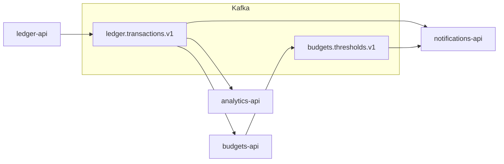

# Architecture

## Philosophy

3T Ledger follows a modular architecture.

Everything is replaceable.

Everything communicates through clear contracts.

---

# Layers

```
Applications

    Web
    Mobile
    Desktop

↓

API Gateway

↓

Business Modules

    Accounts
    Transactions
    Budgets
    Users
    Organizations
    Reports
    Notifications

↓

Infrastructure

    PostgreSQL
    Redis
    Object Storage
    Message Broker
```

---

# Design Principles

- Domain-driven
- API First
- Event Driven
- Modular
- Scalable
- Observable

---

# Audit

Every business operation generates events.

Events can be used for:

- history
- analytics
- synchronization
- notifications
- reporting

## Planned Kafka topics

| Topic | Publisher | Subscribers | Events and purpose |
| --- | --- | --- | --- |
| `ledger.transactions.v1` | `ledger-api` | `analytics-api`, `budgets-api`, `notifications-api` | `transaction.created`, `transaction.reversed`. Analytics updates aggregates for reports, Budgets recalculates spending against limits, and Notifications handles relevant activity on shared wallets. |
| `budgets.thresholds.v1` | `budgets-api` | `notifications-api` | `budget.threshold_reached`. Notifications alerts eligible recipients when spending crosses a configured threshold. |



Each subscribing service uses its own consumer group so that Analytics, Budgets, and Notifications can process the same ledger events independently. Publishers write events to a transactional outbox alongside their business changes. Subscribers handle duplicate deliveries using the event ID.

Analytics and budget calculations are the first consumers planned for personal finance. Notification consumers are introduced in the shared finance phase.

---

# Permissions

Permissions are role-based.

Visibility is always explicit.

Nothing is public unless configured.

---

# Future

Architecture should support:

- plugins
- federation
- multi-tenancy
- distributed deployments
- public APIs
